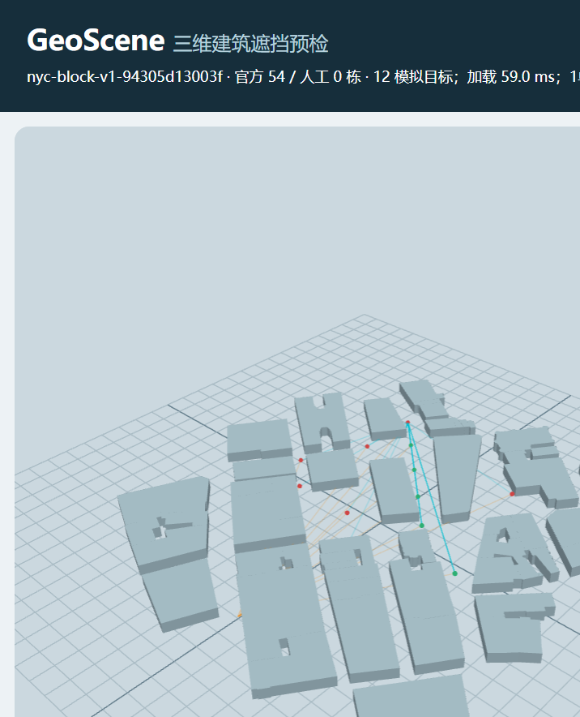

# GeoScene 0.1.0

基于真实公开建筑轮廓的**三维建筑遮挡预检应用原型**。workbench-v1支持人工建筑编辑、服务器确定性分析和报告。Python校验/规则，后台Node调用与浏览器共用的JavaScript/Three.js几何核心；可选DeepSeek Agent选择工具，不替代计算。原模拟首页仍在浏览器计算。

54条真实纽约建筑轮廓、12个模拟目标；全部建筑高度假设10米、地面为平地，观察方案为模拟。不是实测三维城市、机器人导航或商业成熟平台。

## 安装（Windows PowerShell）

在包含package.json的项目根目录打开终端。首次安装：

```powershell
python -m venv .venv
.\.venv\Scripts\python.exe -m pip install -r requirements-dev.txt
npm ci
```

需预先安装Python、Node.js/npm。实际测试版本和环境边界见[验收记录](docs/RELEASE-VERIFICATION.md)。npm使用package-lock.json；Python为版本范围，未来可能解析出不同版本。

## 最短启动

两个终端都进入项目根目录。终端一：

```powershell
.\.venv\Scripts\python.exe -m uvicorn backend.main:app --host 127.0.0.1 --port 8000
```

终端二：

```powershell
npm run dev -- --host 127.0.0.1 --port 5173 --strictPort
```

- **巡检入口**：http://127.0.0.1:5173/inspection.html
- 旧模拟/USGS演示：http://127.0.0.1:5173/
- API文档：http://127.0.0.1:8000/docs
- 健康检查：http://127.0.0.1:8000/health

也可分别运行scripts/start-backend.ps1和scripts/start-frontend.ps1，脚本自动定位项目。若策略禁止脚本，使用上方手动命令，不关闭安全策略。保持两个终端运行；Ctrl+C停止对应服务。端口占用先核对进程归属，不盲目结束进程。

## 报告保存与迁移

默认保存到**当前项目根目录下outputs/inspection-reports/**，自动创建。每次生成独立HTML和同名JSON快照，不依赖启动工作目录或旧任务路径。

可在启动后端前指定环境变量：

```powershell
$env:GEOSCENE_REPORT_DIR = 'outputs/my-reports'
```

支持绝对路径；相对路径始终相对于项目根目录。重启后端生效；空值或未设置使用默认目录。目录不可写返回503及检查提示。自定义目录若放在项目其他位置，需自行添加忽略规则。

旧任务目录中的报告**未删除、未移动**。需要通过接口访问旧报告时，可明确配置其目录；系统不自动搜索或迁移。项目outputs已被Git忽略。docs/example-agent-report.html和同名JSON是刻意保留的历史示例，不随当前运行更新。

## 普通分析与Agent

普通分析、比较、报告导出无需.env和模型账户，不收费。
巡检工具：analyze_batch(target_ids, scheme_id)、compare_observers(target_ids)。
流程：建模或导入人工建筑→设置方案/关键目标→Python校验→后台Node执行共用几何→后台业务规则→结果与同次截图→顶部生成HTML/JSON报告。
后台进程必须能从PATH找到Node；只启动Python但未安装npm依赖会导致分析失败，不会降级成假成功。

## 建筑编辑与报告（workbench-v1）

右侧“建筑编辑”支持矩形及简单多边形。点击“开启地面选点”或直接输入X/Z米制坐标；矩形填写长宽高/旋转，多边形至少3点并闭合。半透明预览不参与分析，确认保存后立即加入障碍物集合。列表选择可修改、删除；撤销保留最近20次人工建筑操作。

人工来源固定manual，高度来源user_input，底面Y=0；官方轮廓只读。多边形自相交拒绝，不自动修复。编辑草稿、方案或目标变化会清空结果并禁用报告，取消草稿后也需要重新分析。

“项目数据→保存人工建筑项目JSON”在后台输出目录落盘并提供下载链接；刷新后通过文件选择器导入恢复。**项目文件仅保存人工建筑及数据版本，不保存观测方案**，方案参数可在分析报告中追溯。输入文件上限1MB，最多100栋人工建筑、每个多边形100点，高度0.1至500米。请先保存再刷新。

顶部“生成正式预检报告 HTML / JSON”使用后台已签发的同次计算快照，包含人工参数、关键覆盖、规则precheck-rules-1、风险和结论；已过期/被改写结果拒绝。服务器内存保留最多64次、一小时，重启后需重算。截图为同次浏览器渲染证据，不是可信渲染认证。

默认54栋建筑高度未确认，因此只可给出条件候选，不作正式推荐；遗漏关键目标不得推荐；零可见目标不进入候选。关键目标为空会披露“未指定”，不能称为关键设备验收通过。

Agent可发“比较方案A和B，关键设备优先，并生成报告”，但须先在方案页明确关键ID。后台在模型请求前验证上下文；模型选择已有工具，工作台执行受控分析/报告服务。2026-10-12已真实验证比较并生成报告、缺参追问和无效对象拒绝。几何数值和最终保护摘要由确定性代码输出，不能将模型应答当成独立计算证据。

只有启用真实Agent才在本机.env配置DEEPSEEK_API_KEY，可选DEEPSEEK_MODEL、DEEPSEEK_BASE_URL。密钥不要发聊天或提交Git。Agent复选框默认关闭，启用后API单独计费。
可参考不含密钥的[配置模板](config.example.env)，按需复制为本地.env；手动功能不需要模型配置。2026-10-12四次真实模型响应合计6374 tokens，实际费用以服务商账单为准。无多轮记忆，追问后重新提交完整指令。

## 独立复现端口

默认保持8000/5173。若同时运行另一个副本，后端终端：

```powershell
$env:GEOSCENE_ALLOWED_ORIGINS = 'http://127.0.0.1:5174'
.\.venv\Scripts\python.exe -m uvicorn backend.main:app --host 127.0.0.1 --port 8001
```

前端终端：

```powershell
$env:VITE_API_BASE_URL = 'http://127.0.0.1:8001'
npm run dev -- --host 127.0.0.1 --port 5174 --strictPort
```

VITE变量进入前端代码，不得放密钥；构建前也要设置，修改后重启Vite或重建。默认跨域来源仅127.0.0.1:5173，localhost不自动视为相同源。不要用关闭安全机制解决跨域。

## 测试与交接

```powershell
.\.venv\Scripts\python.exe -m pytest -q
npm test
npm run build
```

均不调用收费模型。npm run benchmark仅CPU几何计时，不代表网络、模型或GPU性能。

- [首版说明、3分钟演示、5个必须掌握的问题](docs/FIRST-RELEASE.md)
- [本轮复现与验收清单](docs/RELEASE-VERIFICATION.md)
- [数据来源、坐标、许可和假设](public/data/buildings/README.md)

## 当前限制和版本

目标点单射线可见性不是整栋建筑面积比例；无DEM、范围外建筑、树木、精细立面和屋顶，不作为测绘、安全或导航认证。
原首页环境山湖与建筑是装饰；巡检页54个建筑网格实际参与遮挡。USGS归一化演示距离不代表地理距离。
本机接口无身份认证，不要直接开放公网。新workbench/report强制匹配服务器结果；旧inspection/reports保留兼容协议，仅结构一致性检查，不能作为不可信客户端认证。服务器结果缓存要求单worker；未实现跨进程共享缓存。
首次后台连接失败根因尚未确定，后续成功不等于彻底修复，详见验收记录。
代码仓库：[xjxylcr666-lgtm/geoscene](https://github.com/xjxylcr666-lgtm/geoscene)。公开源代码不等于已部署在线后台；请按本页本地启动。没有创建GitHub Release或公网服务。

## 关键文件

backend/inspection.py：报告与巡检协议；backend/validation.py：目标校验；
backend/building_adapter.py：米制转换；src/visibility.js：共用几何；
src/inspection-core.js：批量比较；src/inspection.js：巡检页；src/main.js：旧演示。
backend/workbench.py：人工数据/业务规则/服务端快照；scripts/evaluate-workbench.mjs：共享几何执行器。
最新证据见[发布检查记录](docs/PUBLICATION-VERIFICATION.md)。[工作台验收](docs/WORKBENCH-VERIFICATION.md)及首版文档保留原日期，是历史记录，不代表当前Git或模型实测状态。

## 演示与作品边界

1. 打开巡检页，Agent保持关闭；默认比较A/B：A覆盖5/12、B覆盖0/12。
2. 建筑编辑创建中心(-75,-125)、8×8×10米矩形；目标填inspect-02，重算A应受人工建筑遮挡。
3. 将该建筑高度改为0.5米并确认，检查旧报告禁用；重算A恢复可见，生成HTML/JSON并保存人工项目。

[实际生成的HTML报告](docs/examples/agent-comparison.html)（下载后用浏览器打开）、[同次JSON快照](docs/examples/agent-comparison.json)、[真实异常指令回执](docs/examples/live-agent-check.json)。示例报告是54官方、0人工、默认A/B、关键inspect-02的固定演示，不会随页面变化。



数据来源与改动见[建筑数据说明](public/data/buildings/README.md)，第三方素材和使用条件见[致谢与声明](docs/THIRD-PARTY-NOTICES.md)。

这是licr的学习与工程作品：作者提出业务方向、边界、操作与验收要求，并参与交互测试和结果解释；代码实现、排错、测试和文档使用AI辅助。没有客户访谈、商业部署或效率收益的实证，不应在简历中声称这些经历。

面试前应能独立回答：①局部米制坐标如何从原始地理数据获得？②为什么目标点可见不等于整栋建筑可见？③模型、Python规则和共享JS几何分别负责什么？④编辑后如何阻止旧结果导出？⑤10米假设和平地对结论有哪些限制？
